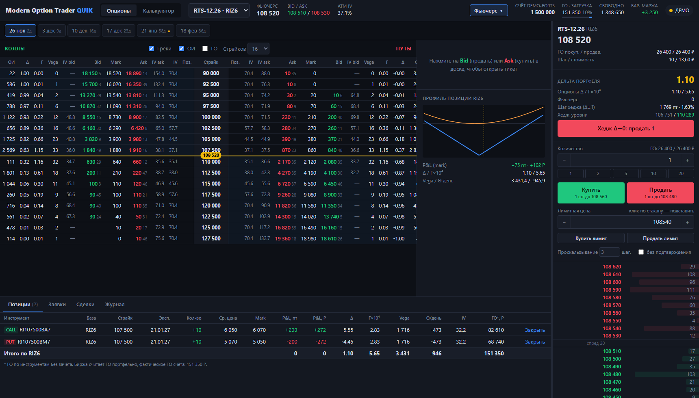
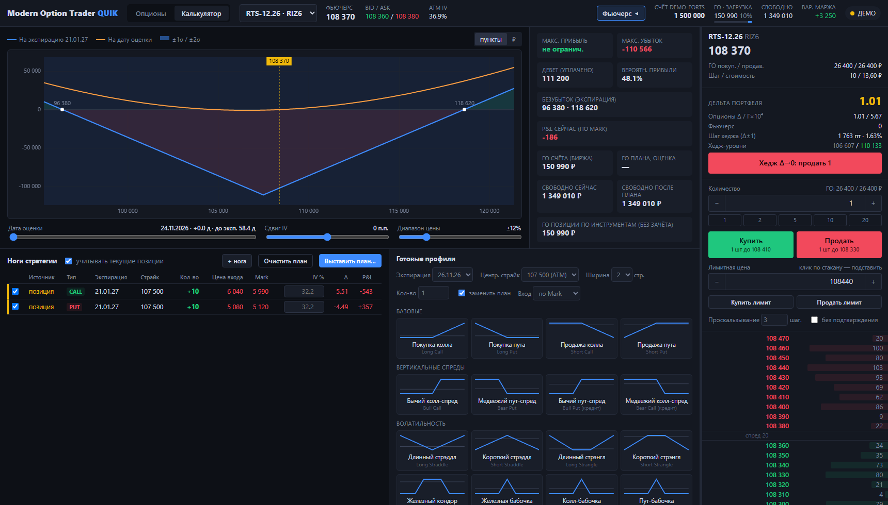

# Modern Option Trader QUIK

**Современный опционный терминал поверх QUIK для срочного рынка MOEX (FORTS).**
Доска опционов в стиле криптобирж (Deribit), опционный калькулятор с готовыми профилями
и панель фьючерса со стаканом и дельта-хеджем для гамма-скальпинга.

QUIK остаётся «движком»: он даёт котировки, позиции и отправляет заявки, а вы работаете
в браузере. Нужны только QUIK и Python, внешних зависимостей нет.

*A modern Deribit-style options trading UI for MOEX derivatives on top of the QUIK terminal:
option chain, strategy calculator with payoff charts, futures order book with one-click delta
hedging. Pure Lua + Python stdlib + vanilla JS.*





> Скриншоты сделаны в демо-режиме на синтетических данных.

---

## Возможности

### Доска опционов
- Коллы слева, путы справа, жёлтая ATM-линия с ценой фьючерса, подсветка ITM.
- Bid / Ask с объёмом, Mark (теоретическая цена биржи), IV bid / ask / mark, Δ Γ Vega, ОИ.
- Колонка **ГО продавца** по каждой серии (включается галочкой «ГО»).
- Ваши позиции прямо в доске; вкладки экспираций с отметкой экспираций, где есть позиции.
- Клик по **Bid** продаёт, клик по **Ask** покупает. Тикет показывает IV по введённой цене,
  греки, премию в пунктах и ₽, **ГО на заявку** и сколько средств останется свободно.

### Панель фьючерса (сплит-режим для гамма-лонга)
- Открывается кнопкой **«Фьючерс»** в шапке и видна и на доске, и в калькуляторе.
  Ширину можно менять, перетаскивая разделитель.
- Стакан на 10 уровней с вашими заявками; клик по цене подставляет её в лимитную заявку.
- **Купить / Продать** одним кликом агрессивной лимитной заявкой: проскальзывание задаётся
  в шагах цены, цена ограничена лимитами биржи. Есть обычные лимитные заявки и «Снять все».
- **Дельта портфеля**: опционы, фьючерс и итог, гамма; *шаг хеджа* (на сколько должна сдвинуться
  цена, чтобы дельта изменилась на 1 контракт) и ближайшие уровни перехеджирования.
- Кнопка **«Хедж Δ→0»** одним кликом выравнивает дельту фьючерсом.
- ГО покупателя и продавца на контракт и на выбранный объём, P&L по фьючерсу.
- По желанию «без подтверждения»: заявки уходят сразу по клику.

### Опционный калькулятор
- Текущие позиции подтягиваются автоматически, каждую можно отключить.
- Плановые ноги добавляются из тикета («+ в калькулятор»), кнопкой «+ нога» или из
  **33 готовых профилей**: вертикальные спреды, стрэддлы и стрэнглы, кондоры и бабочки,
  рацио и бэкспреды, нефритовая ящерица, синтетика, покрытый колл, защитный пут, коллар,
  календари и диагонали.
- График P&L: на экспирацию, на выбранную дату (T+N) и отдельно «только текущая позиция»,
  чтобы сравнить с планом. Зоны ±1σ / ±2σ, точки безубытка, подсказка под курсором.
- Ползунки даты оценки, сдвига IV и диапазона цены; переключатель пункты / ₽.
- Макс. прибыль и убыток (распознаёт неограниченный риск), дебет или кредит, вероятность прибыли,
  греки (позиция / план / итого), сценарии ±1…10%.
- **ГО**: ГО счёта, оценка дополнительного ГО плана, свободные средства до и после плана.
- «Выставить план…» отправляет плановые ноги лимитными заявками после подтверждения.

### Счёт
- В шапке: средства, **ГО с загрузкой счёта в %**, свободные средства, вариационная маржа.
- Поддерживаются обычный счёт FORTS (таблица «Ограничения по клиентским счетам») и
  **единая денежная позиция** (ЕДП, «Клиентский портфель» через `getPortfolioInfoEx`).
- Вкладки «Позиции», «Заявки», «Сделки», «Журнал»; кнопки «Закрыть» и «Снять».

---

## Как это устроено

```
QUIK ──(quik_bridge.lua)──▶ data\out.json ──▶ server.py ──SSE──▶ браузер
     ◀──────────────────── data\cmd.txt   ◀──            ◀─POST── заявки, подписка
```

| файл | назначение |
|---|---|
| `quik_bridge.lua` | скрипт для QUIK: индекс серий, котировки, ГО, стакан, позиции, лимиты, заявки |
| `server.py` | локальный сервер на стандартной библиотеке Python, слушает только `127.0.0.1` |
| `web/app.js` | доска опционов, тикет, позиции и заявки |
| `web/fut.js` | панель фьючерса: стакан, быстрая торговля, дельта-хедж |
| `web/calc.js` | калькулятор и готовые профили |
| `web/bs.js` | модель Black-76 |
| `web/demo.js` | демо-фид на синтетических данных |
| `data/` | обмен с QUIK (`out.json`, `cmd.txt`) |

## Установка и запуск

Требуются QUIK (проверено на QUIK Финам, Lua 5.4) и Python 3.9+.

1. Скачайте репозиторий в любую папку, например `C:\QUIK\modern-options-quik`.
2. В QUIK: *Система → Настройки → Основные настройки → Программа → Получение данных* —
   включите **«“Умный” заказ данных»**. Без этого котировки опционов могут не приходить.
3. В QUIK: *Сервисы → Lua скрипты → Добавить* → `quik_bridge.lua` → *Запустить*.
   В окне сообщений появится «Modern Option Trader QUIK: мост запущен…».
4. Запустите `start.bat` (или `python server.py`) и откройте http://127.0.0.1:8765

Если QUIK не отвечает, интерфейс сам переходит в **демо-режим**. Можно просто открыть
`web/index.html` двойным кликом, тогда будет только демо. Ссылка `…/#calc` открывает
сразу калькулятор.

### Настройки моста (начало `quik_bridge.lua`)

| параметр | по умолчанию | описание |
|---|---|---|
| `ALLOW_TRADING` | `true` | `false` блокирует отправку любых заявок |
| `ACCOUNT` | `""` | торговый счёт FORTS, пусто = автоопределение |
| `CLIENT_CODE` | `""` | код клиента, пусто = как `ACCOUNT` |
| `PERIOD_MS` | `400` | период обновления данных |

Файл `quik_bridge.lua` сохранён в кодировке **windows-1251**, как принято в QUIK.
Редактируйте его в этой кодировке.

## Модель и допущения

- Black-76 при r = 0 (премиальные опционы на фьючерсы MOEX), экспирация в 18:50 МСК.
- Mark — теоретическая цена биржи (`THEORPRICE`), при её отсутствии середина bid/ask.
  IV mark — биржевая волатильность (`VOLATILITY`), при её отсутствии IV считается из mark.
- ГО по инструментам берётся из биржевых ставок `BUYDEPO` / `SELLDEPO`. Биржа считает ГО
  портфельно (с зачётом спредов и хеджей), поэтому сумма ГО по ногам — **оценка сверху**.
  Фактическое ГО счёта берётся из QUIK.
- «Рыночные» заявки — это лимитные заявки с проскальзыванием, ограниченные лимитами цены биржи.

## Безопасность

- Сервер слушает только `127.0.0.1` и принимает команды только со своей страницы.
- Каждая заявка подтверждается в окне. Исключение — панель фьючерса с включённым
  режимом «без подтверждения».
- Скрипт игнорирует команды старше 20 секунд и при перезапуске не повторяет старые команды.
- `data/` не попадает в репозиторий: там ваши реальные позиции и номер счёта.

## Отказ от ответственности

Программа предоставляется «как есть». Торговля деривативами связана с высоким риском.
Автор не несёт ответственности за убытки, ошибки в данных или в работе программы.
Проверяйте заявки и позиции в самом QUIK.

## Лицензия

[MIT](LICENSE)
